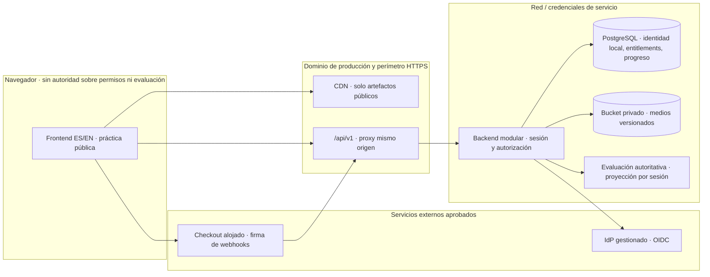

# Digital2Real · Propuesta de arquitectura de producción

**26 de noviembre de 2026 · Propuesta para decisión del titular · v0.1**

La propuesta extiende el frontend ES/EN, el empaquetado de Notebook y el Experience Engine existentes. La autoridad pedagógica sigue en el [Content Model](D2R-CONTENT-MODEL.md), el [Engine](D2R-EXPERIENCE-ENGINE.md) y los estándares [D2R-004](../02-standards/D2R-004-assessment-standard.md), [D2R-005](../02-standards/D2R-005-professional-profile-standard.md), [D2R-006](../02-standards/D2R-006-certification-standard.md) y [D2R-007](../02-standards/D2R-007-learning-analytics-model.md). Un cambio de autoridad del Player requiere decisión según [D2R-008](../03-governance/D2R-008-architecture-governance.md).

## Recomendación para decisión del titular

Mantener el frontend actual. Para el piloto comercial, la configuración de
referencia es Vercel Pro para servir el frontend y redirigir internamente
`/api/v1`, FastAPI en un servicio gestionado en la UE, Supabase Pro en región
UE para PostgreSQL y objetos privados, y Stripe Checkout alojado para cobros.
Evaluar Supabase Auth primero para reducir proveedores y confirmar su formato
de token, flujo de sesión, MFA, DPA y rotación de claves antes de elegir el
adaptador. Usar logs estructurados del alojamiento y sondas de disponibilidad
desde el piloto. Añadir Sentry solo si el volumen y diagnóstico justifican
otro encargado. Con las tarifas base evaluadas, presupuestar USD 52/mes como
referencia de Vercel Pro, Render Starter y Supabase Pro, antes de uso,
impuestos, Stripe y extras. Confirmar región, cuotas, SLA y coste total antes
de contratar. [Vercel](https://vercel.com/pricing) · [Render](https://render.com/pricing) · [Supabase](https://supabase.com/pricing) · [Stripe](https://stripe.com/es/pricing)

La API optativa usa SQLite y claves públicas locales para validar contratos con
datos sintéticos. PostgreSQL, autenticación de producción y certificados
requieren validar el adaptador real, gobierno de sesiones y aislamiento en
staging. El replay Node reutiliza el Experience Engine. La proyección privada
por sesión y su despliegue necesitan una prueba de paridad y una decisión de
arquitectura antes de integrarse con tráfico real.

## Límites de confianza

El CDN entrega Notebook, fichas y práctica aprobada. El backend privado valida permisos, emite proyecciones y mantiene transacciones. Servir `/api/v1` bajo el mismo origen simplifica cookies y CORS. Un único backend modular con PostgreSQL gestionado cubre el MVP. La evolución por carga medida introduce procesos de conciliación, cola duradera si crece el volumen, almacenamiento especializado si domina la transferencia y aislamiento de evaluación si lo exige su integridad. Mantener OpenAPI, SQL migrable y un adaptador pequeño por proveedor.

## Contrato de API propuesto

| Módulo y endpoints representativos | Autoridad y comportamiento |
|---|---|
| `GET /catalog`, `GET /me`, `PATCH /me/profile` | Fichas públicas explícitas. Sesión y propietario derivados en servidor. Perfil con campos permitidos. |
| `GET /experiences/{id}/content`, `POST /assets/{id}/access` | Producto, entitlement, versión y contexto de acceso comprobados por recurso. Procedencia de los IDs desde catálogos y registros controlados. |
| `POST /sessions`, `GET /sessions/{id}`, `POST /sessions/{id}/actions` | Experiencia y versión congeladas al inicio. Comando con versión esperada y clave idempotente, transición atómica. Devolver estado permitido y conflicto coherente si llega una revisión obsoleta. |
| `GET /me/progress`, `GET /me/certificates`, `GET /certificates/{publicId}` | Progreso por propietario. Verificación pública mínima y con limitación de consultas, sujeta al modelo aprobado de privacidad. |
| `POST /billing/checkout`, `POST /billing/portal`, `POST /webhooks/stripe` | Producto y precio desde catálogo servidor, portal vinculado a identidad. Webhook firmado, recepción durable, procesamiento idempotente. |
| `/admin/…`, `/health/live`, `/health/ready` | Operación restringida con MFA y trazabilidad. Health público mínimo si se necesita, readiness detallado interno. |

OpenAPI versionado con esquemas explícitos y límites de longitud, tamaño y cardinalidad. Errores JSON con código estable, ID de correlación y mensajes sin detalles internos. Distinguir 400/422, 401, 403 o 404 según exposición, 409 y 429. Propuesta inicial de timeout de solicitudes interactivas de 5 s, presupuesto menor para llamadas dependientes y límites configurable por IP, sesión y operación. Medir latencia antes de fijar SLO. Validar tamaño y tipo de uploads antes de habilitarlos. Paginación acotada, consultas parametrizadas, log estructurado sin tokens, valores de elección ni PII innecesaria. Revisiones de esquema compatibles, migraciones versionadas probadas en réplica sintética, expandir → migrar → contraer con rollback de aplicación. Pruebas de contrato, permisos cruzados, concurrencia e idempotencia.

FastAPI aporta OpenAPI y validación con Pydantic y encaja con la experiencia del repositorio. El [demo](../../Backend/main.py) carece de módulos productivos. Un runtime TypeScript como alternativa podría reutilizar el Engine directamente si se autoriza evaluación en servidor. Antes del ADR decidir entre backend TypeScript o FastAPI con un runtime de evaluación aislado. Exigir una prueba de paridad sobre fixtures congeladas y evitar una segunda implementación de reglas pedagógicas.

## Identidad y acceso

OIDC Authorization Code con PKCE, state y nonce. El IdP gestiona registro, verificación, recuperación, credenciales y MFA. Respuestas públicas genéricas y límites combinados por cuenta/IP para reducir enumeración y abuso. Sesión opaca gestionada por backend en cookie `__Host-` Secure, HttpOnly, SameSite=Lax y Path=/, rotada al autenticar o elevar privilegios. Logout y recuperación revocan sesiones, con expiración absoluta e inactiva. Proteger mutaciones con verificación Origin/CSRF. Tokens del IdP permanecen en servidor y se validan por emisor, audiencia, firma y expiración. Las cuentas administrativas usan MFA obligatorio y reautenticación en acciones sensibles. Dar accesos de soporte caso por caso, con motivo y auditoría. Aplicar deny by default y comprobar cada recurso en servidor.

| Recurso / operación | Anónimo | Usuario registrado | Admin | Soporte |
|---|---|---|---|---|
| Fichas y práctica pública / leer | Sí | Sí | Sí | Sí |
| Contenido premium / leer | — | Entitlement vigente | Permiso editorial acotado | — |
| Perfil, sesión, progreso / leer y modificar | — | Solo propios y solo campos permitidos | Acceso excepcional auditado | Lectura mínima por caso aprobado |
| Resultado verificable / crear | — | Solicitar evaluación de sesión propia | Operación auditada | — |
| Certificado / verificar | Respuesta mínima por ID opaco | Igual y detalle propio | Emitir/revocar según permiso | Consulta limitada |
| Cobros / checkout, portal o reembolso | — | Checkout y portal propios | Reembolso con permiso específico | — |
| Publicación / administrar | — | — | Permiso explícito, MFA | — |
| Webhook / escribir | Firma del proveedor, identidad de máquina y verificación externa | — | — | — |

## Modelo relacional preliminar

Usar UUID internos, `timestamptz` y precios en unidades menores con divisa explícita. Indicar cada FK en migraciones y elegir restricciones de borrado por finalidad. Usar IdP como autoridad de correo y contraseñas. Separar actividad de aprendizaje, derechos de compra, contabilidad y auditoría.

| Tabla | Claves, restricciones e índices | Datos y ciclo |
|---|---|---|
| `users`, `user_profiles`, `role_grants` | PK UUID, UNIQUE(issuer, subject). Perfil FK 1:1. UNIQUE(user_id, role), índice por rol para revisión. | Nombre visible opcional. Desvincular identidad al cierre y revocar privilegios/sesiones. |
| `products`, `plans` | SKU único. Plan con moneda, intervalo, versión y referencias externas únicas. | Inmutabilidad del plan contratado. Promociones y compras individuales pueden reutilizar productos. |
| `subscriptions`, `entitlements` | FK usuario/plan/producto. ID de proveedor único, FK de origen opcional, constraint fin > inicio, índice por usuario/producto/fin. | Intervalos de derecho independientes del proveedor. Conservar trazabilidad mínima de revocación. |
| `payments`, `webhook_events` | UNIQUE(provider,event_id), UNIQUE(provider,payment_id). Índice de cola por estado y fecha. | Evitar payload completo por defecto. Referencias de facturación conservadas según obligación aplicable, con acceso separado. |
| `experience_sessions`, `experience_actions`, `experience_results` | FK usuario y sesión. Versión de contenido y de evaluación. UNIQUE(session_id, sequence), UNIQUE(session_id, idempotency_key), resultado único por intento. | Caducidad de intentos incompletos, exportación de registros del alumno, anonimización o eliminación según finalidad. |
| `environment_progress`, `capability_progress` | PK compuesta usuario y ENV/ICF. Proyección determinista desde resultados válidos. | MVP puede derivarlas en lectura. Fijar versión de reglas y excluir práctica de la validación de competencias. |
| `certificates` | FK resultado, UNIQUE(public_id) aleatorio, versión, emisión y revocación. | Publicación de datos mínimos. Firma estándar con llave custodiada si se ofrece documento offline verificable. |
| `legal_document_versions`, `legal_acceptances`, `consent_records` | UNIQUE(doc, locale, version). Aceptación contractual separada del consentimiento revocable por finalidad. | Texto aprobado inmutable, hash, hora y prueba de retirada. |
| `audit_events` | ID, actor, acción, objetivo, hora y correlación. Índices objetivo/fecha y actor/fecha. | Escritura limitada, lectura restringida. Sin tokens ni payloads completos. |

En MVP usar roles fijos y grants sencillos. Añadir perfiles avanzados, organizaciones, tablas de permisos o materialización de progreso cuando haya casos aprobados. Aplicar filtros de propietario en consultas y RLS como defensa adicional cuando el contexto de usuario llegue a PostgreSQL. Probar con rol runtime sin BYPASSRLS y rol de migración separado. Definir borrado y anonimización reproducibles con referencias contables retenidas por obligación y ventana de backups documentada. Para una sociedad futura, versionar el emisor contractual y fiscal por transacción y documento. Cambiar el cobro futuro mediante migración aprobada y conservar los IDs de alumno, resultado y certificado.

## Contenido premium y certificación

Clasificar cada YAML y medio antes de empaquetar. Publicar una ficha con descripción y portada aprobadas sin relaciones privadas. Fuente y builds privados en control de acceso separado, fuera del repositorio público y su historial. Bucket privado con política por rol, sin listado público. Autorizar en cada solicitud y emitir URL firmada de vida breve vinculada al objeto/versionado. Las URLs portadoras pueden compartirse hasta su caducidad. Revisar proxy privado para recursos cuya revocación deba ser inmediata. Respuestas privadas con `Cache-Control: private, no-store`; sin tokens de URL en logs, metadatos públicos o HTML estático. Verificar manifiesto por clases, incluidos nombres, mapas fuente, vídeos, medios y copias de staging.

La práctica actual puede entregar el paquete completo y persistir conveniencia local. Para evaluación verificable, el navegador recibe la etapa y opciones visibles. El servidor conserva relaciones, reglas y evidencias futuras. Acepta comandos idempotentes por sesión con control de orden, aplica transición determinista, valida logros y materializa resultado dentro de una transacción. Registrar identidad, versión, fecha, evidencias y criterio de recuperación. Congelar reglas y compatibilidad al iniciar. Hacer explícita la separación de progreso de práctica y competencia evaluada. Un certificado vincula resultado validado, alcance profesional definido por D2R-006, versión y revocación. El verificador devuelve estado, emisor, fecha y alcance mínimo, con identidad pública solo bajo una decisión de privacidad aprobada. Las soluciones ya públicas pueden sobrevivir en clones, caches y archivos de terceros. Seleccionar casos nuevos para evaluación comercial.

## Suscripciones y facturación

Stripe Checkout alojado como candidato. El backend selecciona SKU, moneda e intervalo semestral. Deriva la identidad del cliente de la sesión y persiste una clave idempotente por operación. La vuelta desde Checkout muestra estado pendiente hasta confirmar el pago. Verificar la firma y tolerancia temporal sobre el cuerpo original del webhook, distinguir cuenta y entorno, registrar el ID con restricción única y confirmar recepción tras durabilidad. Un worker interno concilia el estado actual del proveedor antes de actualizar suscripción, cobro y ventana de entitlement en una transacción. Así un evento antiguo o duplicado carece de autoridad para reactivar acceso incorrectamente. Reintentos con backoff y cola de fallos, reconciliación periódica por transacción/periodo, sin datos completos de tarjeta.

| Cambio | Regla a aprobar antes de implementar |
|---|---|
| Pago inicial o renovación confirmados | Emite o extiende derecho hasta el fin de periodo confirmado. |
| Cancelación o expiración | Cancelación al final del periodo conserva plazo pagado. Revocación al expirar. |
| Impago y reintentos | Acordar gracia explícita y máximo. Derecho evaluado por reloj servidor. |
| Reembolso y contracargo | Revisión y revocación según condiciones y estado del proveedor. Rectificación fiscal separada. |
| Promociones y licencias | Grants trazables y con periodo. Ningún producto nuevo implícito. |

Validar sandbox con compra, renovación, duplicación, desorden, firma inválida, expiración, reembolso y reconciliación ante fallos. Stripe reduce contacto con tarjeta, pero el vendedor sigue controlando obligaciones de suscripción, IVA y facturación. Comparar [Stripe Managed Payments](https://stripe.com/es/pricing) y [Paddle](https://www.paddle.com/pricing) si se estudia un comerciante registrado. Verificar países, documentación, comisiones, reembolsos, portabilidad de clientes y alcance de obligaciones. Véase [Privacidad y cumplimiento](../03-governance/D2R-PRODUCTION-PRIVACY.md).

## Proveedores y presupuesto orientativo

Tarifas públicas consultadas el 26 de noviembre de 2026. Las cifras son suelos en USD, sin impuestos, cambios de divisa, soporte, correo, comisiones ni trabajo operativo. Confirmar precios, región y términos contractuales al aprobar.

| Capa | Alternativas y criterio |
|---|---|
| Hosting estático | Pages actual para demostración con subruta y límites de [uso comercial](https://docs.github.com/en/pages/getting-started-with-github-pages/github-pages-limits). Cloudflare Pages/Workers permite CDN, cabeceras y perímetro manteniendo Namecheap como autoridad si se elige una topología compatible. Verificar dominio raíz, TLS y condiciones antes de elegir. Vercel Pro ofrece previsualizaciones y controles, con medición por uso y región. [Cloudflare](https://www.cloudflare.com/plans/developer-platform/) · [Vercel](https://vercel.com/pricing) |
| Backend | FastAPI en contenedor gestionado, por ejemplo Render, con región UE si se confirma disponibilidad. Workers/TypeScript puede simplificar evaluación compartida y reducir operación inicial, sujeto a límites CPU y portabilidad. [Render](https://render.com/pricing) · [Workers](https://www.cloudflare.com/plans/developer-platform/) |
| DB, identidad y medios | Supabase integra Postgres portable, Auth, Storage y backups según plan. Clerk y Auth0 son IdP dedicados con distintas unidades de actividad, MFA, residencia y exportación. PostgreSQL gestionado + S3 compatible desacopla proveedor de objetos y reduce dependencia integrada a costa de más IAM y operación. Exigir DPA, subencargados, pruebas de restauración, exportación y revisión de residencia por servicio. [Supabase](https://supabase.com/pricing) · [Clerk](https://clerk.com/pricing) · [Auth0](https://auth0.com/pricing) |
| Observabilidad | OpenTelemetry para exportar señales sin acoplar el código. Sentry para errores con filtrado de datos y cuotas. Evaluar región, replay desactivado, retención, DPA y costes de exceso. [Sentry](https://sentry.io/pricing/) |
| Dominio y correo | Conservar Namecheap BasicDNS y Private Email mientras se valida compatibilidad. Verificar por separado configuración de correo y hosting raíz. [Namecheap](https://www.namecheap.com/support/knowledgebase/article.aspx/767/10/how-to-change-dns-for-a-domain/) |

| Registrados | Supuestos MAU / almacenamiento / transferencia de medios al mes | Suelo orientativo infraestructura |
|---|---|---|
| 0 | 0 MAU / 0.5 GB / 2 GB | USD 0 en desarrollo local y tiers gratuitos si cumplen límites. |
| 100 | 50 MAU / 2 GB / 10 GB | USD 32+ con Supabase Pro y Render Starter, más perímetro, observabilidad y servicios opcionales. |
| 1.000 | 300 MAU / 10 GB / 100 GB | USD 32+ con las mismas bases de tarifa, sujeto a CPU, CDN y observabilidad. |
| 10.000 | 2.500 MAU / 60 GB / 350 GB | USD 41+ si se mantiene la tarifa base de backend y todo el tráfico supuesto computa como egress no cacheado y supera en 100 GB el cupo de Supabase. Dimensionar backend, backups ampliados y tráfico público. |

Supabase Free documenta 50.000 MAU, 500 MB de DB, 1 GB de objetos, 5 GB de egress y 5 GB cacheados. Pro parte de USD 25, con 100.000 MAU, 100 GB de objetos, 250 GB de egress y tramo adicional no cacheado a USD 0,09/GB. Render Starter publica USD 7/mes como referencia de una instancia, con 512 MB de RAM. Si se elige Vercel Pro, sumar desde USD 20/mes y usos adicionales. Los escenarios son supuestos de capacidad. Dimensionar por tamaño real de medios, frecuencia de consumo, egress cacheado, escritura de eventos, CPU de evaluación y picos. Stripe España anuncia 1,5 % + EUR 0,25 por pago con tarjeta estándar del EEE. Modelar pagos como número de transacciones por coste fijo más volumen por porcentaje, con línea separada para Billing, Tax, tarjetas internacionales y divisa. [Supabase](https://supabase.com/pricing) · [Stripe](https://stripe.com/es/pricing)
