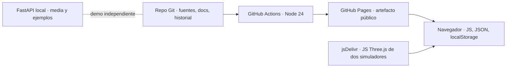

# Digital2Real · Auditoría de seguridad y preparación comercial

**26 de noviembre de 2026 · Arquitectura, seguridad, deuda técnica, operación y cumplimiento**

## Dictamen

**Demostración estática verificada localmente. Lanzamiento comercial pendiente de aprobación.** El workflow de GitHub Pages construye su artefacto en modo `preview`. La compilación reproducida contiene 4 entornos y 40 Experiences gratuitas de práctica, con 80 JSON ES/EN. Los contratos contienen la lógica necesaria para evaluar la práctica en el navegador. Esta entrega aplica controles a la publicación, el demo y la integridad de una dependencia del simulador, y prepara el footer. Los servicios comerciales y su infraestructura están en fase de propuesta.

| Entregable | Documento |
|---|---|
| Inventario, exposición, Threat Model, riesgo, resultados, scorecard y hoja de ruta | Este informe |
| Arquitectura, API, IAM, datos, premium, evaluación, certificados, pagos y costes | [Propuesta de arquitectura](../01-architecture/D2R-PRODUCTION-READINESS-PROPOSAL.md) |
| Registro de tratamientos, almacenamiento, borradores ES/EN y fiscalidad | [Privacidad y preparación legal](../03-governance/D2R-PRODUCTION-PRIVACY.md) |
| Infraestructura, CI/CD, cabeceras, operación, copias y respuesta | [Despliegue, monitorización y recuperación](../workflows/D2R-DEPLOYMENT-AND-RECOVERY.md) |

## Base y gobernanza

Inicio en rama local `work` limpia, commit `2c33b7c8f0bf97d84f4b052ee661d9b74249ffd1`, 1.244 archivos indexados y 196 commits alcanzables desde refs locales. Remoto configurado `I0A1DB200/Web-Digital2Real`. GitHub confirmó visibilidad pública, rama por defecto `main` y repositorio activo. La versión efectivamente desplegada, cabeceras, configuración Pages y DNS/correo no se pudieron verificar desde este entorno. [Repositorio en GitHub](https://github.com/I0A1DB200/Web-Digital2Real)

Autoridad revisada en [AGENTS](../../AGENTS.md) y el [índice canónico](../README.md). Playbook v2, Engineering OS Architecture v1, Experience Engine y Content Model según sus rutas canónicas, D2R-001 a D2R-008 según el índice (D2R-001/002/004/005/006/007/008 v1.0.0, D2R-003 en su edición de método canónica), [QA Standard](../02-standards/D2R-STD-004-qa-standard.md) y [Validation Baseline](../VALIDATION_BASELINE.md). El encargo se clasifica ARCHITECTURE y TECHNICAL DEBT. El Engine, su Player, YAML pedagógicos y binarios quedan fuera del alcance de implementación de este paquete.

## Arquitectura comprobada

| Superficie | Evidencia observada |
|---|---|
| App | HTML/CSS y ES Modules nativos. `Frontend/app.js` enruta hashes exactos de Notebook, Experience Lab y About, con fallback estable. La preferencia ES/EN es compartida. |
| Notebook | Fuente en `content/notebooks`, empaquetador `scripts/package-notebook.mjs`, catálogo/locale generados. El visor construye elementos y usa texto para el contenido técnico. |
| Experiencias | FUENTE YAML en `content/experiences`, ENV en `content/environments`, generación en `scripts/package-experience-engine.mjs`, proyección y Player en `experience-engine/`. Catálogo, medios, evaluador y Player generados llegan al navegador. |
| Otros recursos | Dos simuladores 3D como iframes de mismo origen, lector documental de la célula y demo PLC accesible por archivo en `Frontend/plc`. Medios JPEG, PNG, SVG, WebP, MP4. Escenas de Three.js construidas por JavaScript en HTML. |
| Dependencias | jsDelivr Three.js 0.149.0 (cobot) y 0.164.1 (célula), ambos con versión explícita. Actions checkout v4, setup-node v4, configure-pages v5, upload-pages-artifact v3, deploy-pages v4. Sin manifiesto/lock JS ni Python en el repositorio. |
| API de demo | `Backend/main.py` crea `media/videos`, monta `/media` y define GET `/`, `/api/videos` y `/api/posts`. FastAPI añade documentación OpenAPI, Swagger y ReDoc por defecto. Routers, modelos y servicios del árbol son esqueletos. El workflow Pages no ejecuta ni publica el backend. |
| Datos y operación | Preferencia local y progreso de práctica. Sin BD, IdP, sesiones servidor, API de pagos, gestión de certificados, monitorización de aplicación o copias comerciales localizadas. El correo y DNS se evaluaron como dependencias declaradas con verificación externa pendiente. |

### Exposición y clasificación

| Clase | Recursos y alcance |
|---|---|
| PUBLIC previsto | `index.html`, JS/CSS, SVG, imágenes, vídeos, Notebook, fichas públicas, simuladores y documentación didáctica que carga el lector. El paquete local equivalente al workflow contiene 457 archivos y 437.847.668 bytes antes de `.nojekyll`. La reproducción del paquete conserva 20 Markdown, entre ellos documentos del lector y documentación de recursos. |
| PUBLIC por diseño de práctica | El modo actual produjo 40/40 registros `free` y `practice`. Cada JSON incluye etapas, feedback, `public.interactions`, `evaluation_policy` y finalización. El código local aplica esas reglas. `preview` incluye contenido todavía en revisión y entornos de previsualización. `publish` en raíz aislada produjo 2 Experiences y omitió 40 fuentes. |
| PUBLIC accidental en el empaquetado anterior | `cp -a Frontend/. _site/` incorporaba directorios `tests` con fixtures y expectativas. Excluidos del artefacto revisado. Los archivos que también existen en Git público siguen siendo recuperables por esa vía. |
| INTERNAL por finalidad, visible en Git público | Fuentes de autoría YAML/locale, autoridades internas de proyección, prompts, docs de implementación, evidencias QA, logs, archivos ZIP de assets e historial. El workflow toma `Frontend/` como raíz y excluye el resto del árbol, mientras Git distribuye archivos rastreados. No inferir que reducir el artefacto retire contenido previamente clonado, cacheado o indexado. |
| AUTHENTICATED, PREMIUM, ADMINISTRATIVE | Clasificaciones previstas. Ningún control servidor, protección comercial o consola de administración encontrada en esta vista. Aplicar clasificación y almacenamiento privado antes de incorporar esas clases. |
| SECRET | Ninguna coincidencia confirmada en el barrido descrito. Infraestructura futura debe mantener secretos, llaves de firma, registros sensibles y copias privadas fuera del artefacto y del historial público. |

### Secretos

Inspección de rutas sensibles, configuración y workflows con salida limitada a metadatos. Barrido de las refs locales antes de cambios sobre 2.349 blobs únicos, de los cuales 1.740 se clasificaron como texto y se escanearon. Patrones de credenciales de GitHub, AWS, Google, Stripe, Slack, npm, Supabase, claves privadas, URLs con credenciales y asignaciones evidentes. Cero coincidencias y cero nombres identificados de archivos de configuración sensibles en ese histórico. El barrido excluyó binarios, archivos comprimidos y textos de 2 MB o más. No alcanzó refs remotas ausentes, objetos no alcanzables, forks, Actions logs remotos ni credenciales de alta entropía que carezcan de patrón. Activar revisión de secretos en el proveedor si está disponible. Ante un hallazgo, documentar ubicación y categoría redactadas, revocar en origen y revisar accesos antes de evaluar remoción histórica.

## Revisión defensiva

Mapa basado en [ASVS 5.0.0](https://owasp.org/www-project-application-security-verification-standard/), criterios web y [OWASP API Security Top 10](https://owasp.org/API-Security/). Es un diagnóstico por superficie y no una atestación ASVS.

| Familia | Razonamiento y resultado |
|---|---|
| XSS e inyección HTML | App y About usan plantillas con cadenas de módulos locales versionados. Notebook y Workspace usan nodos de texto para datos de catálogo. Los simuladores usan HTML dinámico sobre registros/estados locales. El lector Markdown escapa texto, resuelve documentos mediante catálogo y genera vínculos. El contenido editable por terceros cambiaría esta frontera y necesita sanitización y allowlist URL canónica. Sin flujo confirmado de entrada externa a HTML ejecutable en las rutas revisadas. |
| Routing, redirección y rutas de recurso | El hash tolera codificación inválida y queda limitado a vistas aprobadas. Enlaces de iframe usan ruta local normalizada; catálogos/JSON determinan assets y módulos del Engine. Revisar política de rutas y origen en toda futura ingesta. Demo sirve media mediante Starlette, sin ruta propia construida desde parámetros enviados. |
| Framing y dependencias | Iframes y lector requieren acceso mismo origen para su interacción actual. CDN corre código dentro del contexto de simuladores. SRI aplicado al script clásico; el módulo ES de la célula permanece en CDN. Antes de sesiones reales conviene aislar origen o controlar bytes servidos. No se encontraron flujos de `postMessage` en los módulos revisados. |
| Acceso y datos | API de demo con GET y datos ficticios sin dependencias de propietario. El wildcard CORS era una configuración confirmada, con impacto presente bajo. BOLA/IDOR, mass assignment y CSRF de acciones autenticadas quedan para la futura API. La práctica local puede modificarse en el dispositivo por diseño. |
| API y disponibilidad | Sin entradas de negocio, consulta SQL, carga de archivos por usuario ni proxy SSRF en el demo revisado. No hay cuotas, WAF ni controles productivos. Limitar recursos y errores antes de abrir API con tráfico real. Error del Workspace en EN puede mostrar mensajes técnicos originados en catálogo o ejecución, con prioridad de revisión al introducir API de producción. |
| Dependencias Python | El entorno local tenía FastAPI 0.141.1, Starlette 1.9.0, Pydantic 2.14.1 y Uvicorn 0.52.1. El aviso GHSA-f56c-v883-vx8r abarca esa versión de FastAPI para rutas con parámetros query/header. Las tres rutas propias inspeccionadas no declaran esos parámetros. Fijar una versión corregida y ejecutar SCA antes de incorporar rutas reales. Versiones del entorno local no prueban las de otros entornos. [Aviso del mantenedor](https://github.com/fastapi/fastapi/security/advisories/GHSA-f56c-v883-vx8r) |
| Cabeceras | TLS, framing, CSP, HSTS, referrer, MIME, permisos y caché reales quedaron pendientes. La [estrategia HTTP](../workflows/D2R-DEPLOYMENT-AND-RECOVERY.md#cabeceras-http) registra política por ruta, iframe y dependencia. |

## Threat Model y registro de riesgos

Activos: fuentes y soluciones, reglas de puntuación, medios premium, intentos verificables, identidad, autorizaciones y derechos comprados, facturación, certificados, artefactos de despliegue, llaves, dominio y disponibilidad. Actores: visitante o alumno, usuario de otra cuenta, operador/administrador, proveedor, mantenedor de dependencias y terceros con copia histórica. Límites: Git público → build → CDN público, navegador → API, API → IdP/BD/bucket, webhook externo → cola interna, y administración separada. Usar STRIDE por flujo y reevaluar en el ADR y en staging.

| ID · gravedad | Evidencia o escenario | Mitigación / estado / responsable |
|---|---|---|
| S01 · Alta para lanzamiento | Divulgación de reglas y soluciones de práctica por diseño. Confianza en el navegador invalidaría usos premium o verificables. | Confirmado en compilación. Clasificar casos y usar proyección con autoridad servidor. Responsable Arquitectura / Contenido. |
| S02 · Media | Catálogo público configurado como `preview`, 38 registros de diferencia frente a `publish`. Si se trata como producción, el gate de validación editorial queda desalineado. | Confirmado localmente. Conservar la demostración. Preservar aprobación editorial por canal y exigir manifiesto de publicación para producción. Responsable Contenido / Operaciones. |
| S03 · Baja | Tests incluidos por copia íntegra del frontend y permisos Pages/OIDC en build. | Confirmado. Exclusión, comprobación de ausencia, credencial no persistente y permisos acotados en la rama. Activación tras revisión. Responsable CI. |
| S04 · Baja hoy | CORS comodín del demo permitía lecturas cross-origin de contenido público. | Confirmado. Desactivar por defecto y permitir orígenes exactos configurados, GET. Responsable Backend. |
| S05 · Media | Compromiso de dependencia CDN o Actions. JS con privilegios de su contexto e integridad del build. | SRI en cobot, con deuda en módulo de célula, pin de Actions y SCA. Responsable Frontend / CI. |
| S06 · Media | Dependencias Python sin lock, aviso aplicable al intervalo instalado y condicionado por declaraciones de endpoints. | Revisar SCA, fijar transitivas al introducir app real y usar aislamiento. Responsable Backend. |
| S07 · Alta en producción | Suplantación de cuenta/administración, acceso cruzado, manipulación de sesiones o abuso de entitlements. | Diseñado, pendiente. IdP, MFA, CSRF, control por propietario/recurso y auditoría. Responsable Backend / Titular. |
| S08 · Alta en producción | Webhook falso, duplicado, fuera de orden, impago o reembolso mal reflejado, con pérdida económica. | Diseñado, pendiente. Firma, eventos únicos, reconciliación y transacciones. Responsable Billing. |
| S09 · Alta en producción | Certificado emitido sobre estado manipulable o pérdida de trazabilidad. | Diseñado, pendiente. Resultado servidor, versión, revocación, privacidad. Responsable Evaluación. |
| S10 · Alta en producción | Fuga por logs, URLs firmadas, backups, soporte o caché compartida. | Diseñado, pendiente. Retención, límites de acceso, logs redactados, pruebas de restauración. Responsable Operaciones / Privacidad. |
| S11 · Alta comercial | Hosting de demo no apto para producto comercial, fiscalidad, derechos y documentos por aprobar. | Pendiente de proveedor, revisión legal y aprobación del titular. |
| S12 · Media | Caída, costes inesperados, secuestro de dominio o interrupción de correo. | Verificar DNS y cuentas, preparar alertas, copias, incidente y rollback. Responsable Operaciones / Titular. |

No se identificaron hallazgos críticos confirmados dentro de las superficies verificadas. Los estados relativos al servicio externo siguen sujetos a acceso y evidencia.

## Controles implementados en la rama

- `.github/workflows/deploy-pages.yml` ejecuta tests después de generar el catálogo y antes de preparar el upload, excluye `tests` de la copia, desactiva credenciales persistentes de checkout y limita permisos de escritura al job deploy. Retira la mutación automática del origen Pages. El entorno existente debe estar configurado en modo Actions para desplegar.
- `Backend/main.py`, `.env.example` y `.gitignore` acotan orígenes del demo y preparación local. Se conservan los GET de ejemplo y el directorio de medios.
- `Frontend/simulators/cobot/index.html` usa SRI SHA-384 y CORS anónimo con la misma versión de Three.js. El digest se obtuvo sobre el recurso CDN y los bytes coincidieron con el paquete oficial npm.
- `Frontend/app.js`, `Frontend/data/site.js`, `Frontend/components/footer.js`, `Frontend/styles.css`, `Frontend/styles/footer.css` y `Frontend/components/tests/footer.test.js` integran el footer ES/EN y documentan/contactan por el correo dado. El footer se oculta durante simuladores y Experiences. Los borradores legales permanecen bajo `docs/` con rutas futuras especificadas.
- El paquete incluye este informe, tres documentos de propuesta, enlaces del índice de documentación y changelog.

## Validación y límites

- Suite compartida de Node 24: 571/571, incluida la regresión del footer. Comando: `find scripts experience-engine Frontend -type f \( -name '*.test.js' -o -name '*.test.mjs' \) -print0 | xargs -0 node --test`.
- Sintaxis JS del frontend, 74 referencias de import/export relativas de módulos de aplicación, estructura YAML del workflow y `git diff --check` verificados. Reempaquetado local Notebook y Engine en preview. Compilación publish aislada comparada con preview. El artefacto servido bajo `/Web-Digital2Real/` excluyó los directorios test y retuvo simuladores y lector documental.
- Demo FastAPI local: 200 en los tres GET, CORS desactivado por defecto, CORS explícito para origen permitido, sin permiso para origen distinto, y configuración comodín rechazada.
- Chromium real a 390 y 1440 px: Notebook y Escape, footer ES/EN, foco, hash inválido, Atrás/Adelante, Experience Lab, apertura/cierre de ambos simuladores y visibilidad del canvas, Workspace y estado del footer. Se sirvieron en la prueba los bytes de Three.js descargados del CDN, con cabecera CORS, para aislar disponibilidad externa. La verificación incluyó carga de subruta, sin errores de página ni HTTP locales en los recorridos. EE-0033 completada a 390 px en ES y 1440 px en EN desde el mapa ENV-004, con una opción incorrecta que mantiene la etapa, tres pantallas Result, Debrief y persistencia local del resultado. Se abrió Theory de ENV-004 y se comprobó almacenamiento de progreso antes de recargar.
- No se ejecutó una validación remota de Pages/DNS/correo, auditoría exhaustiva de advisories, inspección visual humana formal ni matriz WCAG completa. La prueba funcional local no acredita los controles de configuración ni protege la distribución pública.

## Production Readiness Scorecard

| Área | Estado | Justificación |
|---|---|---|
| Frontend Security | PARTIAL | Construcción y QA local, riesgo CDN restante, cabeceras en vivo pendientes. |
| API Security | PARTIAL | Demo local y allowlist verificados. API comercial pendiente. |
| Secrets Management | PARTIAL | Barrido local y exclusión env. Gestor productivo y comprobación remota pendientes. |
| Dependency Security | PARTIAL | Inventario y SRI parcial. Faltan lock, SCA y pin verificado. |
| Authentication | NOT IMPLEMENTED | IdP y revocación en propuesta. |
| Authorization | NOT IMPLEMENTED | Controles por rol, recurso y propietario en propuesta. |
| Premium Content Protection | NOT IMPLEMENTED | Catálogo público de práctica y fuentes en Git. |
| Database Security | NOT IMPLEMENTED | No hay DB comercial. |
| Payment Security | NOT IMPLEMENTED | Contrato de integración, entorno de prueba por aprobar. |
| User Privacy | PARTIAL | Inventario dirigido y persistencia local observada. Falta validar proveedores, retención y derechos operativos. |
| Legal Compliance | BLOCKED | Datos del titular, condiciones, revisión de mercados y aprobación jurídica/fiscal pendientes. |
| Certification Integrity | NOT IMPLEMENTED | Propuesta autoritativa y verificable, práctica cliente vigente. |
| Infrastructure | BLOCKED | Artefacto local probado. Parámetros y cabeceras remotos, DNS/correo y elección de host pendientes. |
| CI/CD | PARTIAL | Pipeline endurecido localmente, ejecución GitHub, protección de rama y aprobación de entorno pendientes. |
| Monitoring | NOT IMPLEMENTED | Métricas, alertas y propietarios propuestos. |
| Backups | NOT IMPLEMENTED | RPO, RTO y restauración propuestos. |
| Incident Response | PARTIAL | Runbook preparado. Faltan rotación de guardia, contactos y simulacro. |

## Roadmap y decisiones de lanzamiento

| Fase | Entrega y condición de salida |
|---|---|
| 0 · Auditoría y hardening | Revisar esta rama y verificar settings Pages, artefacto remoto y política de publicación de demo. Clasificar todos los futuros recursos privados y confirmar controles CI. |
| 1 · Legal y privacidad | Titular aprueba datos, mercados, términos, fiscalidad, retención, DPA y documentos. Validar derechos y almacenamiento en staging. |
| 2 · Infraestructura | Aprobar proveedor, costes, región y DNS compatible. Desplegar staging con TLS, cabeceras, alertas y rollback comprobado. |
| 3 · Identity & Access | Aprobar IdP, runtime, sesión y DB. Verificar MFA, revocación, propiedad, CSRF, RLS y aislamiento. |
| 4 · Premium | Aprobar mapa de producto y nuevos casos privados. Verificar que builds y Git público carecen de material clasificado premium, probar autorización, firmas y caché. |
| 5 · Billing | Aprobar pasarela/contrato, términos semestrales, política de gracia y proveedor fiscal. Completar sandbox con conciliación y errores. |
| 6 · Progress & Certification | Aprobar evaluación y certificar paridad con Engine. Verificar datos versionados, revocación, privacidad y restauración. |
| 7 · Production Readiness | Ensayar recuperación, incidentes y compra de punta a punta en staging. Revisar ASVS por superficie y aprobar independientemente lanzamiento, fiscalidad y cumplimiento. |

**Git:** rama `feature/d2r-security-production-readiness`, HEAD base `2c33b7c8f0bf97d84f4b052ee661d9b74249ffd1`. El commit inicial de auditoría fue `1972dde`. La rama se actualizó con main `c68f7c4` y se publicó para revisión en el [PR #18](https://github.com/I0A1DB200/Web-Digital2Real/pull/18).

## Seguimiento de la revisión

La actualización conserva la navegación con enlaces directos y la identidad de
pestaña de main. Pasaron 598 pruebas locales y Chromium verificó enlace directo,
recarga, historial y visibilidad del footer a 390 px ES y 1440 px EN. El
workflow ahora valida los PR sin ejecutar los pasos que escriben en Pages.
La revisión de publicación, settings y ramas protegidas sigue siendo un gate.
El siguiente trabajo autorizado y los bloqueos se registran en
[Project Status](../PROJECT_STATUS.md#production-readiness-workstream).
